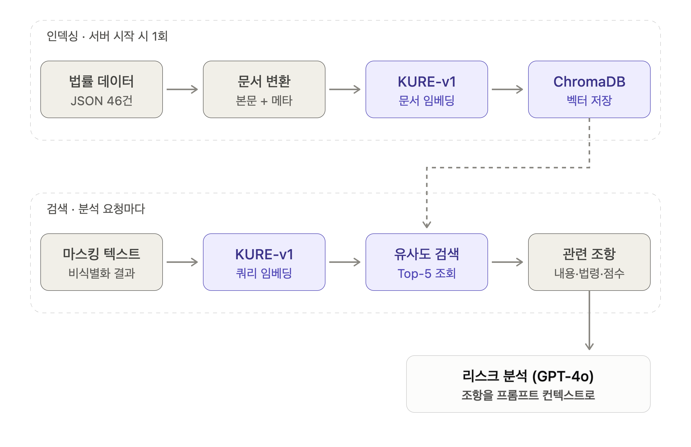

## 개요 📃

2026 한이음 ICT 멘토링에서 정보보호학과 팀으로 개발한 **안심 계약 가디언**이다. 시설 퇴소 후 처음으로 전세 계약을 맺는 자립 준비 청년이 독소 조항이나 전세사기의 표적이 되지 않도록, 계약서 사진만 올리면 위험 조항을 탐지하고 위험도를 알려준다. 계약서 이미지는 OCR로 텍스트를 추출한 뒤 이름·주소·주민번호 등 개인정보를 먼저 마스킹하고, 마스킹된 텍스트만 GPT-4o에 전달한다. 주택임대차보호법·표준계약서·독소 조항·전세사기 판례 46개 항목을 벡터 DB에 적재한 RAG로 근거 기반 분석을 수행하고, 공공 API로 주소 검증·건물 정보·전세가율을 조회해 0~100점 위험도와 지역별 자립지원기관 안내를 제공한다.

## 역할 🙋🏻‍♂️

✦ Backend 담당 — FastAPI 초기 프로젝트 구조(api / services / schemas / core) 및 환경 설정 세팅, CLOVA OCR 텍스트 추출 서비스와 이미지 분석 엔드포인트 구현

✦ RAG 파이프라인 구현 — KURE-v1 임베딩 + ChromaDB 벡터스토어 구축, 법률 데이터 임베딩 및 서버 기동 시 자동 적재, 분석 완료 후 개인정보 매핑 테이블 삭제(purge) 로직 구현

## Skills 🛠️

✦ Python, FastAPI, Pydantic

✦ LangChain, ChromaDB, HuggingFace Embeddings (KURE-v1)

✦ CLOVA OCR, GPT-4o

✦ Redis

## RAG 파이프라인 개발 🔒

법률 데이터 46건은 서버 시작 시 1회만 KURE-v1로 임베딩해 ChromaDB에 저장하고, 분석 요청마다 마스킹된 계약서 텍스트를 같은 모델로 임베딩해 유사도 Top-5 조항을 조회한 뒤 GPT-4o 리스크 분석의 프롬프트 컨텍스트로 전달합니다.

---

## 서버 기동 실패: 임베딩 모델 로딩 오류

### AS-IS

서버가 시작될 때 법률 데이터를 임베딩하기 위해 모델을 불러오는 단계에서 HuggingFace `401 Repository Not Found` 에러가 발생하며 서버 기동이 중단되었습니다. 에러 로그를 추적해 원인을 좁혀 보니 존재하지 않는 모델 ID(`upskyy/kure-roberta-small`)를 지정한 것이 문제였습니다. 또한 기동할 때마다 같은 법률 데이터를 다시 임베딩할 수 있는 구조여서, 재시작 시 중복 임베딩이 쌓일 위험이 있었습니다.

### TO-BE

모델 식별자를 정확한 **`nlpai-lab/KURE-v1`로 교체**해 기동 문제를 해결했습니다. 임베딩 모델과 벡터스토어는 **싱글톤(`lru_cache`)으로 1회만 로드**하고, 컬렉션에 데이터가 이미 있으면 **재임베딩을 건너뛰도록** 해 재시작 시 중복 임베딩을 방지했습니다. 벡터 저장소 디렉토리(`db_store/`)는 버전 관리에서 제외해 로컬 임베딩 결과가 저장소에 섞이지 않도록 정리했습니다.
